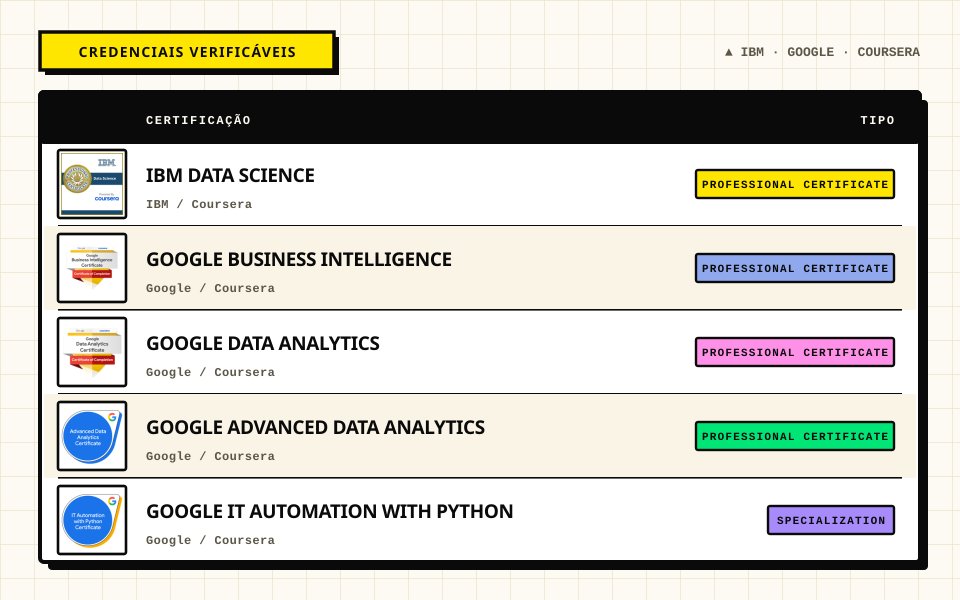

  <picture>
    <source media="(prefers-color-scheme: dark)" srcset="https://raw.githubusercontent.com/samuel-c-santos/samuel-c-santos/main/files/cards/hero-dark.svg">
    
  </picture>

##  Sobre mim

Trabalho com dados ambientais e territoriais há mais de sete anos, unindo geoprocessamento, engenharia de dados e desenvolvimento de software. Minha rotina é construir bases espaciais, dashboards e automações que outras equipes usam para decidir.

Atualmente coordeno a área de geotecnologias do IDEFLOR-Bio, responsável pela inteligência espacial das Unidades de Conservação do Pará. Antes, passei pela SEMAS, com regularização ambiental e análise de dados.

- **ATUANDO AGORA:** Coordenador de Geotecnologias no IDEFLOR-Bio
- **FORMAÇÃO:** Mestrado em Biologia Ambiental (UFPA), especialização em Ciência de Dados (UNAMA) e especialização em Geoprocessamento e Solos (UFRA)
- **LOCALIZAÇÃO:** Belém, Pará
- **FOCO:** Geoprocessamento, Business Intelligence e automação de processos

##  O que eu faço

- **Inteligência espacial:** PostGIS, QGIS, GDAL, sensoriamento remoto e modelagem ambiental.
- **Business Intelligence:** dashboards em Power BI, pipelines em Python e R e relatórios técnicos.
- **Software e automação:** geovisores, aplicações web e rotinas que eliminam trabalho manual.

  <picture>
    <source media="(prefers-color-scheme: dark)" srcset="https://raw.githubusercontent.com/samuel-c-santos/samuel-c-santos/main/files/cards/stack-dark.svg">
    
  </picture>

##  Projetos em destaque

- **[GeoVicinal](https://github.com/samuel-c-santos/amazoniahack):** roteamento topológico offline sobre estradas vicinais não oficiais da Amazônia. Grafo binário CSR de 29,3 MB e Dijkstra rodando no navegador.
- **[Pórtica](https://github.com/samuel-c-santos/portica-app):** calculadora estrutural de vigas de concreto armado conforme a NBR 6118:2023, com parser FTOOL, relatórios em PDF e desenhos em DXF.
- **[Visualizador Geoespacial](https://ngeo-ideflor-bio.github.io/visualizador/):** aplicação web para visualizar, filtrar e exportar camadas de Unidades de Conservação, terras indígenas e quilombos.

<a href="https://samuelsantos.site/#projetos"><strong>ver todos os projetos →</strong></a>

##  Certificações

  <picture>
    <source media="(prefers-color-scheme: dark)" srcset="https://raw.githubusercontent.com/samuel-c-santos/samuel-c-santos/main/files/cards/certs-dark.svg">
    
  </picture>

  <a href="https://www.coursera.org/account/accomplishments/professional-cert/S77137BIW3BB">IBM Data Science</a> · <a href="https://www.coursera.org/account/accomplishments/professional-cert/6O9UOEAOR8SC">Google Business Intelligence</a> · <a href="https://www.coursera.org/account/accomplishments/professional-cert/UCL8PA52WE22">Google Data Analytics</a> · <a href="https://www.coursera.org/account/accomplishments/professional-cert/FERD3VNVCZUX">Google Advanced Data Analytics</a> · <a href="https://www.coursera.org/account/accomplishments/specialization/TMPQCW1K8GJU">Google IT Automation with Python</a>

##  Métricas

  

  <picture>
    <source media="(prefers-color-scheme: dark)" srcset="https://raw.githubusercontent.com/samuel-c-santos/samuel-c-santos/main/files/cards/cta-dark.svg">
    
  </picture>

  &nbsp;
  &nbsp;
  &nbsp;
  &nbsp;
  

 

  Belém, Pará · <a href="https://dot.cards/samuelsantos">cartão digital</a> · <a href="https://github.com/samuel-c-santos/cartografia">portfólio de cartografia</a>

