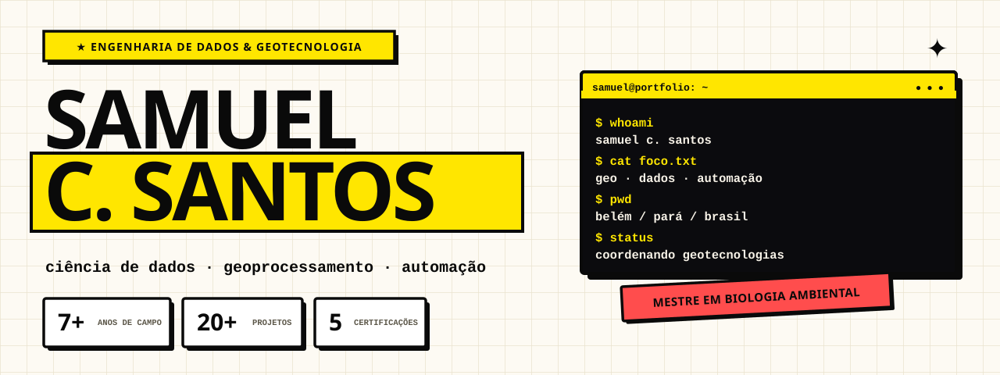
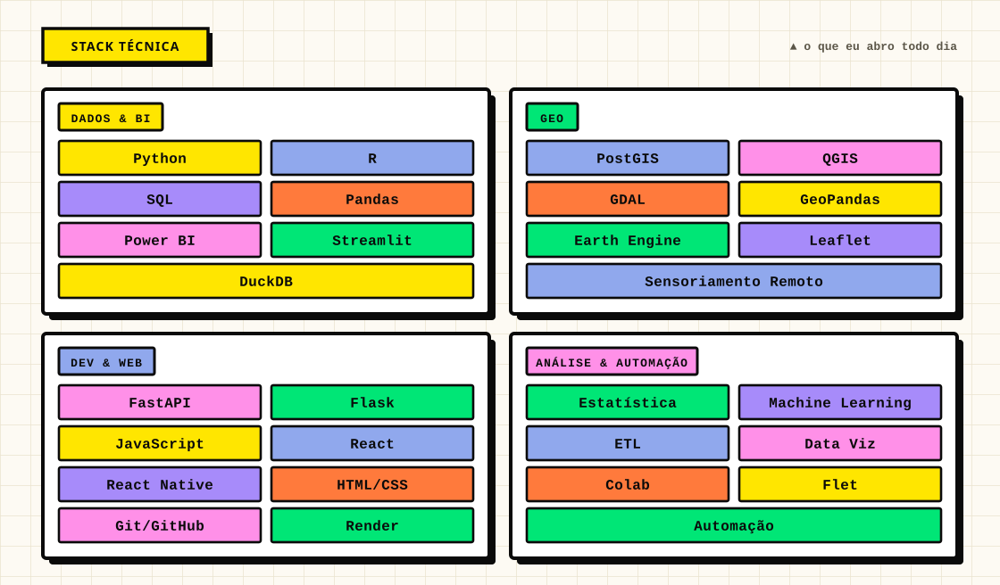
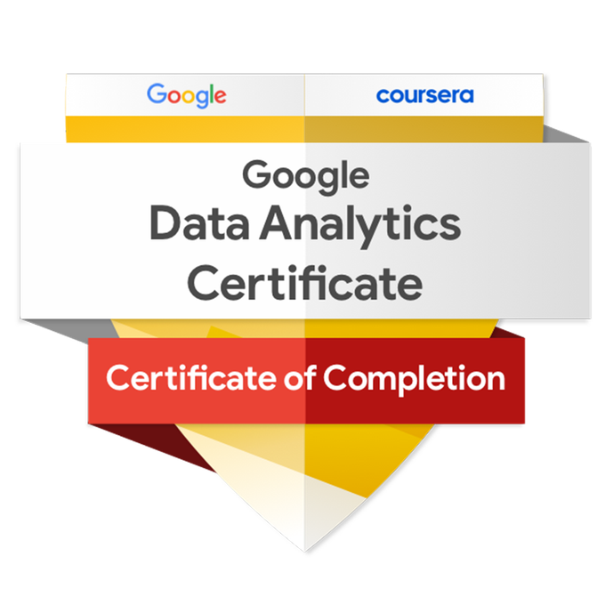
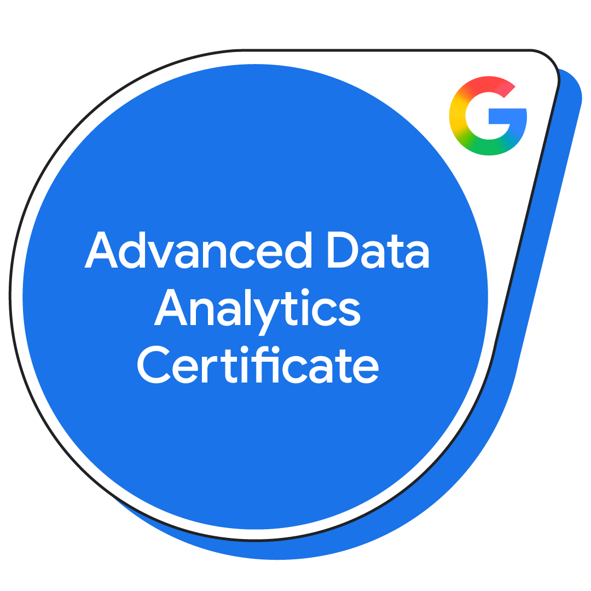
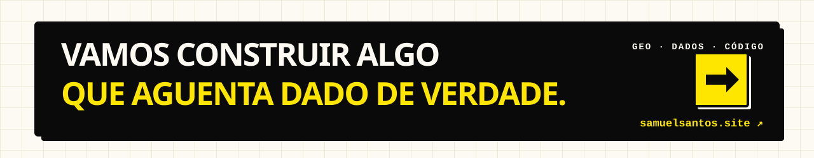

  <picture>
    <source media="(prefers-color-scheme: dark)" srcset="https://raw.githubusercontent.com/samuel-c-santos/samuel-c-santos/main/files/cards/hero-dark.svg">
    
  </picture>

##  Sobre mim

Trabalho na fronteira entre **dado, território e software**. São mais de sete anos convertendo rotina técnica em sistema: bases espaciais que respondem em milissegundos, dashboards que aposentam planilha em circulação e automações que devolvem dias de trabalho para a equipe.

Hoje coordeno geotecnologias no **IDEFLOR-Bio**, cuidando da inteligência espacial das Unidades de Conservação do Pará. Antes disso, passei pela **SEMAS**, por regularização ambiental e por pesquisa aplicada em sensoriamento remoto.

- **AGORA** · Coordenador de Geotecnologias no IDEFLOR-Bio
- **FORMAÇÃO** · Mestrado em Biologia Ambiental (UFPA) · Especialização em Ciência de Dados (UNAMA) · Especialização em Geoprocessamento e Solos (UFRA)
- **TERRITÓRIO** · Belém, Pará — Amazônia
- **FOCO** · Geoprocessamento · Business Intelligence · Automação de processos

##  O que eu faço

- **Inteligência espacial** — PostGIS, QGIS, GDAL, sensoriamento remoto e modelagem ambiental aplicada a território real.
- **Business Intelligence** — dashboards em Power BI, pipelines em Python e R, relatórios que sustentam decisão e não enfeite.
- **Software & automação** — geovisores, aplicações web e rotinas que eliminam trabalho manual repetitivo.

  <picture>
    <source media="(prefers-color-scheme: dark)" srcset="https://raw.githubusercontent.com/samuel-c-santos/samuel-c-santos/main/files/cards/stack-dark.svg">
    
  </picture>

##  Projetos em destaque

- **[GeoVicinal](https://github.com/samuel-c-santos/amazoniahack)** — roteamento topológico offline sobre estradas vicinais não oficiais da Amazônia. Grafo binário CSR de 29,3 MB e Dijkstra rodando no navegador, sem internet.
- **[Pórtica](https://github.com/samuel-c-santos/portica-app)** — calculadora estrutural de vigas de concreto armado conforme a NBR 6118:2023, com parser FTOOL, relatórios em PDF e desenhos em DXF.
- **[Visualizador Geoespacial](https://ngeo-ideflor-bio.github.io/visualizador/)** — aplicação web para visualizar, filtrar e exportar camadas de Unidades de Conservação, terras indígenas e quilombos.

<a href="https://samuelsantos.site/#projetos"><strong>ver todos os projetos →</strong></a>

##  Certificações

  
  
  
  
  

##  Métricas

  

  <picture>
    <source media="(prefers-color-scheme: dark)" srcset="https://raw.githubusercontent.com/samuel-c-santos/samuel-c-santos/main/files/cards/cta-dark.svg">
    
  </picture>

  &nbsp;
  &nbsp;
  &nbsp;
  &nbsp;
  

 

  Belém · Pará · Amazônia — <a href="https://dot.cards/samuelsantos">cartão digital</a> · <a href="https://github.com/samuel-c-santos/cartografia">portfólio de cartografia</a>

